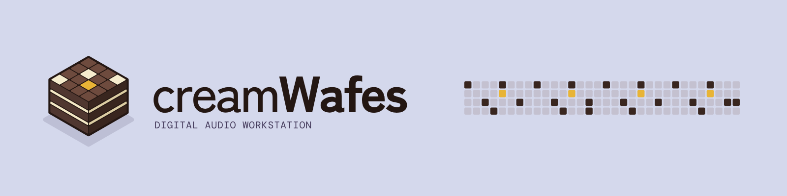
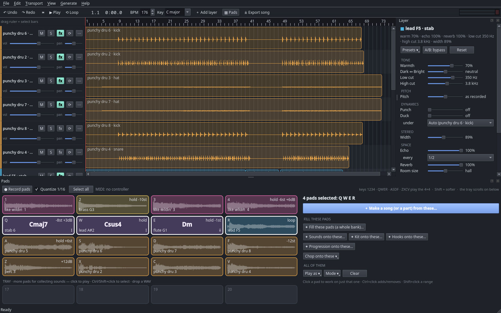

<p align="center">
  <picture>
    <source media="(prefers-color-scheme: dark)" srcset="docs/brand/readme-banner-dark-1600x400.png">
    
  </picture>
</p>

**Make sounds with AI, play them on pads, build songs from them.** A native desktop mini-DAW
(Qt) where a local AI model ([ACE-Step 1.5](https://github.com/ace-step/ACE-Step-1.5), MIT code and
weights) makes the raw material — one kick, an 808, a chord loop, a vocal layer, eight bars to redo —
and you do the rest: play it, chop it, shape it, arrange it, export it. Everything runs on your own
machine.

It's deliberately *not* a "type a sentence, get a song" app. The AI is a sound source; the music is yours.



## Why this exists

> I tried a bunch of the servcies from the below table and could not get the thing i wanted to make
> once, not even remotely possible and talk about a shit experience to long to never generate to the
> right got damn thing and no way to edit it to what you wanted and so many damn one shot song tools,
> all these billions of dollars made all these companies fucking weak as shit to making actual useful
> tools holy fuck, so i spent like 8 hours making this and eating chocolate cocoa wafers with vanllia
> cream (hence name) thats how spiteful this is im just sick of your shit and theres no way i can get a
> refund for using your shit ass services you fucking cunts, also this works on 6gb of vram card a
> fucking 1660 super you fucking shit cunts needs data centres to produce shit fuck i hate you, do better

https://github.com/user-attachments/assets/9f2f6444-fc62-4370-98d1-693b6cf438ba

### The breakdown (October 2026)

| Service | What it does | Where it runs | Notes |
|---|---|---|---|
| Suno | Text/lyrics → whole song | Cloud | v6 (Sept 2026) made with Warner, BMG, Believe; Suno Studio browser DAW |
| Udio | Text/lyrics → whole song | Cloud | Settled with UMG; reviews in 2026 report downloads disabled |
| Mureka | Text/lyrics → whole song | Cloud, API | V9.5, "O3" model |
| ElevenLabs Music | Text → whole song | Cloud, API | Music v2 (May 2026) |
| Google Lyria 3 / 3.5 (Flow Music) | Text → ~3 min song | Cloud, API | SynthID watermark in everything |
| Producer.ai (was Riffusion) | Chat → song | Cloud | Folded into Google Labs (Feb 2026) |
| MiniMax Music | Text → whole song | Cloud, API | Reportedly closed to new API customers (Aug 2026) |
| Alibaba HappyShrimp | Text → whole song | Cloud | Beta (Aug 2026) |
| Boomy | One-click songs | Cloud | Free tier limits downloads/monetising |
| Soundraw · Beatoven.ai · Mubert · Loudly · Soundful | Background / royalty-free tracks | Cloud | For videos, streams, ads |
| AIVA | Orchestral / cinematic scores | Cloud | MIDI export |
| Stable Audio 2.5 / 3 | Instrumental audio | Cloud API; v3 open weights | v3 makes up to 6:20, no vocals |
| 💛 **ACE-Step 1.5** | **Songs, layers, repaint** | **Local, MIT** | **What creamWafes runs on** (XL needs 12–20 GB) |
| 💛 **HeartMuLa · YuE · DiffRhythm 2 · SongGeneration 2 · MusicGen** | **Song generation models** | **Local, open weights** | Mostly want 12–16 GB+ VRAM; some non-commercial |
| **creamWafes** | **Sounds → pads → your song, every bit editable** | **Local, 6 GB VRAM** (GTX 1660 SUPER) | **MIT, free** |

💛 **Not these.** ACE-Step and the open models are sick cunts — fucking awesome: free, open weights, running on
your own machine. creamWafes only exists because ACE-Step put theirs out there. (Stable Audio 3's open weights
count too.)

## What it does

**Pads**
- A 4×4 played with the keyboard (**1234 · QWER · ASDF · ZXCV**, Shift = softer), the mouse, or any USB
  MIDI pad controller (auto-connects), MPC layout. Below it, a **tray** of pads that never runs out —
  somewhere to collect sounds and pick from.
- Any pad plays as a **Sample**, a **Chord** of the song's key (pick i, iv, VI…; triad, 7th, sus2, sus4,
  add9; strum), or a **Note** of the key (808s, bass lines, leads). A sound's pitch is detected so it
  stays in key. Hold **G** 7th · **H** sus4 · **B** sus2 · **N** add9 while playing chords.
- Modes: One-shot, Hold (sustains the sound itself), Loop, Play-on. Pitch, volume, ● record what you play
  (quantised) onto a track.
- Fill pads by dropping audio files, chopping a timeline clip or file (a clean drum **kit**, at each hit,
  every beat or bar), right-click a clip → **Add to the pad tray**, or generating.

**Generating sounds** (✦ Generate on a pad)
- 32 kinds: drums (kick, snare, clap, hats, rim, perc, crash, ride), 808 / sub / bass, keys, bells,
  guitar, strings, brass, flute, lead, pad, stab, vocal chops, choir, risers, impacts — and **loops**
  (drum, perc, bass, chord, melody, vocal) in whole bars at your tempo.
- Genre and mood buttons, Short/Medium/Long, 4 or 8 takes to audition — keep one, or **every take on its
  own pad**. **✦ Variation** remakes a pad's own sound, a little or a lot different.
- With several pads selected: a different take on each, or **✦ Fill these pads** — one vibe becomes a
  kit, 808, chord pads in a progression, melody, hook, FX, drum loop.
- Chord progressions for a mood, AI hooks (phrases or one-shots) onto pads.

**Building songs from your sounds**
- Select pads → **✦ Make a song (or a part)**: an arrangement of *exactly those sounds* — drum patterns
  with fills, the chord pads as the progression, bass on the roots, hooks in the choruses — as a full
  song, a short one, or **just a part** (an 8-bar verse, a chorus…) at the playhead. Styles: trap,
  drill, house, lofi, pop, dnb. Every pad gets its own track; right-click → **Song part** to change what
  it plays or how its notes sound (short, full sample, held), or ⟳ for a new variation.

**Timeline and layers**
- **＋ Add layer**: the AI hears your song and adds a part (drums, bass, keys, strings, vocals…). For
  vocals, drums and bass it can **keep only the new part** (separated out with Demucs). Right-click any
  track → **Keep only ▸ Vocals / Drums / Bass / Everything else**.
- Redo or extend part of a layer **in place** (drag bars on the ruler, or the Layer panel's
  *Generate part of this layer* / *Find a gap*).
- Move, split, duplicate, mute/solo, volume/pan, undo/redo everything, autosave.

**Layer panel** (right side; click a track or its **fx** button) — non-destructive per-track sound:
warmth, dark↔bright, low/high cut, pitch (keeps the speed), punch, duck under the kick (sidechain),
width, tempo-synced echo, reverb; presets and A/B bypass.

**Export** — **⤓ Export song**: MP3 (320–128 kbps), WAV, FLAC, OGG, Opus, AIFF, M4A; 44.1/48 kHz; the
whole song, selected bars or from the playhead; level as mixed, peak-normalised, or loudness-matched for
streaming (−14 LUFS) / clubs (−9 LUFS) with a limiter. **Export stems** writes every track as WAV for
another DAW (Ardour, Reaper…).

## Requirements

- **Linux** (developed on Fedora 43, GNOME/Wayland). Windows and macOS: the app is Qt and should run,
  but nothing there is tested yet.
- An **NVIDIA GPU with 6 GB or more** (tested on a GTX 1660 SUPER, 6 GB; newer cards are faster).
  AMD/Intel GPUs and CPU-only are untested.
- About **20 GB** of disk (models ~10.5 GB, the engine's Python environment ~7.7 GB).
- [**uv**](https://docs.astral.sh/uv/) and git. Optional: `rubberband` (pitch in the Layer panel),
  `ffmpeg` (M4A export).

## Install

```bash
git clone https://github.com/James-Chahwan/creamWafes.git
cd creamWafes
tools/setup_engine.sh        # ACE-Step 1.5 at the tested version, its environment, the models
cd app && uv sync            # the app
uv run creamwafes            # start it (or: uv run creamwafes ~/Music/creamWafes/<song>)
```

Optional, on Linux: `tools/install_desktop.sh` puts creamWafes in your app menu and dock with its icon
(`--remove` takes it out again).

The first start of the engine compiles some kernels and takes a few minutes; the status bar says
**Engine ready** when the AI buttons work. Songs, exports and logs live in `<your Music folder>/creamWafes`.

## Quick start

1. **P** shows the pads. Click a pad → **✦ Generate…** → pick *kick*, a genre, a mood → audition the takes.
2. Do the same for a snare, hats, an 808 (or select 8–16 pads → **✦ Fill these pads** for a whole set).
3. Select four empty pads → **✦ Progression onto these** for chord pads in your key.
4. Play them (1234 / QWER / ASDF / ZXCV), or **● Record pads**.
5. Select the pads you like → **✦ Make a song (or a part)** → Space to listen.
6. Click a track → shape it in the Layer panel; **＋ Add layer** for vocals or another part.
7. **⤓ Export song**.

**F1** lists every shortcut.

## Settings (environment variables)

| Variable | What |
|---|---|
| `CREAMWAFES_HOME` | where songs, exports and logs go (default `<Music>/creamWafes`) |
| `CREAMWAFES_ENGINE` | path to the ACE-Step checkout (default `engine/ACE-Step-1.5` next to `app/`) |
| `CREAMWAFES_NO_TURBO=1` | don't load the turbo model (saves RAM; single sounds use the base model) |
| `CREAMWAFES_NO_ENGINE=1` | start without the AI engine (editing/playing only) |

## Troubleshooting

- **"CUDA out of memory"** — close other GPU-heavy apps; very long songs need more memory for add-layer.
  The engine frees the GPU after every job and retries once on its own.
- **No sound** — creamWafes plays through your default output (PipeWire/PulseAudio); check it there.
- **Logs** — `<Music>/creamWafes/session.log` (what happened, errors) and `engine.log` (the AI side).

## Development

```
app/       the desktop app (PySide6) — package creamwafes, tests in app/tests
engine/    ACE-Step 1.5 checkout + models + its own environment (not in git; tools/setup_engine.sh)
tools/     setup_engine.sh, install_desktop.sh, test.sh, creamwafes-inspect.py, benchmarks
packaging/ the Linux desktop entry
docs/      screenshot; docs/brand has the logo, icons, banners and palette
```

```bash
tools/test.sh    # every end-to-end test: offscreen, fake engine, real audio through a silent null sink
```

`tools/creamwafes-inspect.py state | screenshot [path] | log [n] | restart` talks to the running app
over a local socket only your user can open (handy for debugging what someone sees).

## Releases

Releases are numbered like an album in progress: **v0.1, v0.2, …**, and each one comes with a song made
in that version, attached to the release. When the album is finished, the version goes to **v1.1**.

## Credits

Built on [ACE-Step 1.5](https://github.com/ace-step/ACE-Step-1.5) (MIT), [Demucs](https://github.com/facebookresearch/demucs)
(MIT) and [PySide6/Qt](https://www.qt.io/qt-for-python) (LGPL). Full list: [THIRD_PARTY.md](THIRD_PARTY.md).
For what the AI models were trained on and how their output may be used, see ACE-Step's model card.

## Licence

MIT — see [LICENSE](LICENSE).
